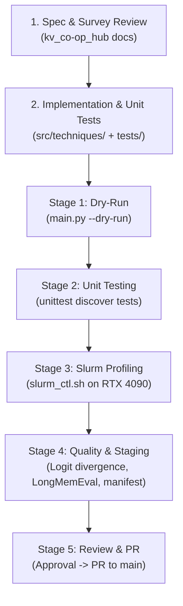

# WP3 Candidate Technique Execution & Contribution Workflow

> **Audience:** Developers, Contributors, and Autonomous Agents working on KV-Cache Co-Optimization Work Packages (`[WP3-1]` through `[WP3-12]`).  
> **Repository:** `kv_bench` (Execution Plane) & `kv_co-op_hub` (Coordination & Data Staging).

---

## 1. Architectural Scope & Guardrails

Every technique in `WP3` reproduces a published KV-cache optimization method across three primary axes:
* **Structural Axis:** Token-level eviction / sliding window retention (e.g., StreamingLLM, H2O).
* **Spatial Axis:** Cache quantization, compression, and head pruning (e.g., TurboQuant, HeadQ, QServe).
* **Temporal Axis:** Hierarchical host/device offloading and prefetching (e.g., FlexGen, ShadowKV, CacheGen, InfiniGen, ArkVale, EpiCache).

### Strict Boundary Rules
1. **Unmodified Base Weights:** All models strictly evaluate base weights in original BF16/FP16 precision. Never apply AWQ/GPTQ/GGUF to model weights—all optimizations target the dynamic KV-cache exclusively.
2. **Hardware Ceilings:**
   * **Cluster (HPC):** 16.0 GiB physical VRAM cap (`gpu4090` partition, model `qwen3-4b`).
   * **Local:** 8.0 GiB physical VRAM cap (RTX 4060, model `qwen3-1.7b`).
3. **Package & Environment Management:** Strictly use `uv run <command>` (never use raw `pip install` or activate virtual environments manually).

---

## 2. Work Package Lifecycle: The 5-Stage Protocol

Each technique (`WP3-X`) follows a unified single-track branch and pull-request workflow:

```
main ──> feat/wp3-X-<technique> ──[Stage 1-4 Verification]──> PR ──> main
```



### Stage 1: Specification & Implementation (Local)
1. Read the corresponding technique literature survey in `../kv_co-op_hub/docs/literature_survey/techniques/<technique>.md`.
2. Create and checkout the feature branch:
   ```bash
   git checkout -b feat/wp3-X-<technique>
   ```
3. Implement `src/techniques/<technique>.py`:
   * Subclass `Technique` from `src.core.technique`.
   * Register with `@register("<technique>")`.
   * Set `axes = Axis.<STRUCTURAL|SPATIAL|TEMPORAL>`.
   * Return valid `vllm.EngineArgs` in `engine_kwargs(context_length, max_tokens)` (e.g., `block_size`, `hf_overrides`). Never pass unrecognized technique parameters to `EngineArgs`.
   * Implement runtime hooks or memory manager patches inside `setup()`.
   * Populate `extra_metrics()` for telemetry.
4. Add comprehensive unit tests in `tests/test_<technique>.py` testing registration, argument parsing, math/boundary calculations, and tensor stability.

### Stage 2: Local Verification (No GPU Required)
Before touching any cluster resources, verify the code locally:
```bash
# 1. Stage 1 Dry-Run (Verifies argument parsing and engine_kwargs across context lengths)
uv run main.py --technique <technique> --model qwen3-4b --dry-run

# 2. Stage 2 Unit Test Suite (Must pass cleanly with zero errors/failures)
uv run python -m unittest discover tests -v
```

### Stage 3: Remote Cluster Profiling (KMUTT Slurm Cluster)
All remote operations **strictly use** `./.agents/scripts/slurm_ctl.sh`. Never craft ad-hoc `ssh`/`scp` commands or run compute workloads on login node `ctl01`.

```bash
# 1. Sync tracked source code to cluster ~/kv_bench/
./.agents/scripts/slurm_ctl.sh sync

# 2. Submit batch execution on gpu4090 partition
./.agents/scripts/slurm_ctl.sh submit qwen3-4b

# 3. Monitor execution status at safe intervals (e.g., every 15-30s)
./.agents/scripts/slurm_ctl.sh status <job_id>
./.agents/scripts/slurm_ctl.sh logs <job_id> 50

# 4. Fetch telemetry and logs back to local workspace
./.agents/scripts/slurm_ctl.sh fetch <job_id>
```

### Stage 4: Quality & Provenance Staging
1. **Pillar 1 (Micro Logit Divergence):**
   * Compare logits against `results/baselines/references/baseline_qwen3-4b_ref.json`.
   * Verify and record `top1_agreement`, `kl_div_mean`, and `kl_div_p99`.
2. **Pillar 2 (Macro LongMemEval Adherence):**
   * Run `MemoryAdherenceWorkload` across the 50-sample evaluation suite.
   * Record `longmem_acc_overall`, `longmem_macro_f1`, and capability metrics.
3. **Data Staging in `kv_co-op_hub`:**
   * Stage consolidated JSON outputs to `results/runs/wp3/<technique>_hardware_16gb.json` in `kv_co-op_hub`.
   * Generate SHA256 manifest at `results/manifests/run_manifest_wp3_<technique>.json`.
   * Do not commit multi-gigabyte raw log/tensor files.

### Stage 5: Human Review & Pull Request Protocol
1. Present Stage 1–4 verification summaries to the developer for explicit confirmation.
2. Once approved, push the branch to origin:
   ```bash
   git push -u origin feat/wp3-X-<technique>
   ```
3. Open a Pull Request targeting `main`:
   ```bash
   gh pr create \
     --title "feat(technique): reproduce and profile <technique> [WP3-X]" \
     --body "<Verification summary and metrics>
   
   Closes #<ISSUE_NUMBER>" \
     --base main
   ```
4. Wait for review, merge into `main`, pull locally, and delete the feature branch.

---

## 3. Retrospective: Retiring Jules & Simplifying the Flow

Earlier during the tracer bullet for `WP3-1` (StreamingLLM), work was split into two sub-issues:
* `[WP3-1-1]` Foundation & Dry-Run Suite (assigned to Google Jules cloud agent).
* `[WP3-1-2]` Slurm Cluster Execution & Profiling (assigned to human/cluster).

### Key Takeaways from the Tracer Bullet:
1. **Cloud Container Limitations:** Google Jules environment setup failed due to Nix/CUDA compilation dependencies (`vllm`, `flash-linear-attention`), lack of GPU devices, and the impending Jules platform wind-down (Nov–Dec 2026).
2. **Unnecessary Branch Complexity:** The split required stacked branches (`feat/wp3-1-1` $\rightarrow$ `feat/wp3-1` $\rightarrow$ `main`), creating double review cycles and synchronization overhead.
3. **Direct Single-Track Solution:** Because Antigravity operates natively with full local tool access and cluster wrapper scripting, **we no longer create Phase A / Phase B sub-issues**. Every subsequent work package (`WP3-2` through `WP3-11`) uses the unified 5-stage lifecycle directly on its own `feat/wp3-X` branch.

---

## 4. Cheat Sheet: Frequently Used Commands

| Action | Command |
| :--- | :--- |
| **Dry-Run Technique** | `uv run main.py --technique <name> --model qwen3-4b --dry-run` |
| **Run Unit Tests** | `uv run python -m unittest discover tests -v` |
| **Sync Code to Cluster** | `./.agents/scripts/slurm_ctl.sh sync` |
| **Submit Slurm Job** | `./.agents/scripts/slurm_ctl.sh submit qwen3-4b` |
| **Check Job Status** | `./.agents/scripts/slurm_ctl.sh status <job_id>` |
| **Fetch Cluster Results** | `./.agents/scripts/slurm_ctl.sh fetch <job_id>` |
| **Cancel Slurm Job** | `./.agents/scripts/slurm_ctl.sh cancel <job_id>` |
